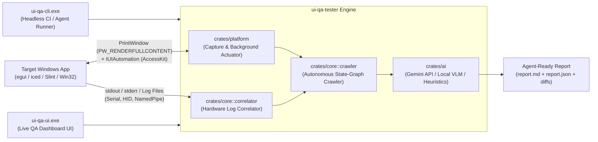

<div align="center">

# UI QA Tester 🎯 🔬

**Autonomous, Non-Intrusive Windows UI & Hardware-in-the-Loop (HIL) QA Agent for Rust Native GUI Applications (`iced`, `egui`, `Slint`)**

[](https://github.com/DooperDrew/ui-qa-tester/actions/workflows/ci.yml)
[](https://github.com/DooperDrew/ui-qa-tester/releases/latest)
[](https://www.rust-lang.org/)
[](LICENSE)
[](https://microsoft.com/windows)
[](#key-capabilities)

<br/>

| 📖 [User Guide](docs/user-guide.md) | 🪄 [Setup Wizard](scripts/setup-wizard.ps1) | 🧪 [Self-Test QA](docs/06-qa-and-validation.md) | 📦 [WinGet & Releases](docs/release-methodology.md) | 🤝 [Community Plan](docs/08-community-and-growth-strategy.md) | 🤖 [Architecture](docs/multi-agent-methodology.md) |
|:---:|:---:|:---:|:---:|:---:|:---:|

</div>

---

## The Problem

Testing Windows desktop applications connected to physical hardware (serial controllers, USB/Bluetooth HID devices, embedded probes) is notoriously frustrating:
- **Focus stealing:** Traditional automated UI testing tools hijack your physical mouse cursor and bring windows to the foreground, preventing you from writing code or doing other work while tests run.
- **Silent hardware failures:** A UI button appears clicked, but the underlying COM port timed out, dropped a packet, or silently `NACK`ed without surfacing an error to the screen.
- **Opaque custom widgets:** Modern GPU-rendered Rust desktop apps (`iced`, `egui`, `Slint`) use canvas painting and `wgpu` rather than native Win32 controls, breaking legacy test runners.
- **No actionable fix prompts:** Traditional test tools spit out stack traces or opaque pixel diffs without telling developers how to fix the Rust GUI code.

`ui-qa-tester` solves this by providing a **hands-free, non-intrusive QA agent** that runs in the background, extracts deep `AccessKit` / UIA trees, brackets every click with real-time hardware logs, critiques visual defects via multimodal AI, and writes **agent-ready Markdown reports** ready for AI coding agents to fix.

---

## ✨ Key Capabilities

1. **100% Non-Intrusive Background Capture (`PrintWindow(PW_RENDERFULLCONTENT)`):**
   - Captures full-resolution screenshots of GPU-rendered `wgpu`/DirectX windows (`iced`, `egui`, `Slint`) even when occluded or behind your IDE (`p95 latency ≤ 50 ms`, zero focus stealing).
2. **Three-Tier Hands-Free Actuation:**
   - **Tier 1:** Windows UI Automation (`IUIAutomationInvokePattern` / `AccessKit` nodes).
   - **Tier 2:** Background `HWND` message injection (`PostMessageW` with automatic `window_rel_to_client_coords` conversion for Windows 11 DWM borders and title bars).
   - **Tier 3:** Optional lightweight `ui-qa-sdk` crate for white-box widget inspection and synthetic input.
3. **Hardware Log Correlation (`stdout`, `stderr`, diagnostic files):**
   - Brackets every UI action with a configurable `[-50 ms, +1500 ms]` window to catch silent timeouts, `NACK`s, serial disconnects, and UI thread hangs (`IsHungAppWindow`).
4. **Dual-Layer Visual & UX Critic:**
   - Combines deterministic geometric heuristics (overlapping siblings, horizontal clipping, missing `AccessKit` names, WCAG AA luminance contrast) with **Google Gemini Multimodal API** (`gemini-2.5-flash`) or **Local OpenAI-compatible VLMs** (Ollama, LM Studio).
5. **Live QA Dashboard UI (`ui-qa-ui.exe`) & Headless CLI (`ui-qa-cli.exe`):**
   - Features 7 interactive views: Session Setup, Live Run with synchronized timeline, Findings Inspector with 1-click **Copy Agent Fix Prompt**, Baseline Visual Diff, Onboarding Setup Wizard, Interactive Subsystem Self-Test Matrix, and Architecture Explorer.

---

## 🏗️ Architecture Overview



---

## 📥 Download & Installation

Pre-built Windows x64 binaries are published on [**GitHub Releases**](https://github.com/DooperDrew/ui-qa-tester/releases/latest) — no Rust toolchain required:

### Option 1: Microsoft WinGet (Recommended)
```powershell
# Install directly from local repository manifest:
winget install --manifest packaging/winget/manifests/d/DooperDrew/UiQaTester/0.2.0/

# Or via community repository:
winget install DooperDrew.UiQaTester
```

### Option 2: Scoop Package Manager
```powershell
scoop install https://raw.githubusercontent.com/DooperDrew/ui-qa-tester/main/packaging/scoop/ui-qa-tester.json
```

### Option 3: Guided Windows Setup Wizard (Zero-Elevation GUI)
1. Download `ui-qa-tester-v0.2.0-windows-x64.zip` from [GitHub Releases](https://github.com/DooperDrew/ui-qa-tester/releases/latest).
2. Extract the archive and double-click **`setup.cmd`** (or run `.\scripts\setup-wizard.ps1`).
3. The wizard installs into `%LOCALAPPDATA%\Programs\ui-qa-tester`, adds the binaries to your User `PATH`, creates Start Menu and Desktop shortcuts, and registers in Windows Settings ("Installed apps") with clean uninstallation support.

*For silent CI deployments:*
```powershell
.\scripts\setup-wizard.ps1 -Silent
```

### Option 4: Portable ZIP Archive
Extract `ui-qa-tester-v0.2.0-windows-x64.zip` anywhere and run `ui-qa-ui.exe` or `ui-qa-cli.exe` directly. Zero registry keys touched.

---

## 🚀 Quick Start

### 1. Launch the Live QA Dashboard UI
```powershell
ui-qa-ui.exe
```
- Click **"▶ Run Hands-Free Self-Test Demo"** to see background capture, non-intrusive actuation, and hardware log correlation in action.
- Use the **🪄 Setup Wizard** tab to pre-populate presets for `egui`/`MagicBridge`, `iced`, `Slint`, or `Win32`.
- Use the **🧪 Self-Test & QA Matrix** tab to verify host latencies and export a QA verification certificate.

### 2. Run the Headless CLI
```powershell
# Built-in end-to-end self-test
ui-qa-cli.exe self-test

# Run background QA against an external app (e.g. MagicBridge)
ui-qa-cli.exe run --config examples/magicbridge-qa-session.toml

# Generate a starter configuration file
ui-qa-cli.exe init-config --path qa-session.toml

# List discoverable desktop windows
ui-qa-cli.exe windows
```

---

## 📚 Documentation System

- [Central Documentation Hub (`docs/README.md`)](docs/README.md)
- [User Guide (`docs/user-guide.md`)](docs/user-guide.md)
- [UX Improvements & Onboarding Backlog (`docs/07-ux-and-improvements.md`)](docs/07-ux-and-improvements.md)
- [Community & Multi-Framework Growth Strategy (`docs/08-community-and-growth-strategy.md`)](docs/08-community-and-growth-strategy.md)
- [Release Methodology (`docs/release-methodology.md`)](docs/release-methodology.md)
- [Multi-Agent Orchestration & Methodology (`docs/multi-agent-methodology.md`)](docs/multi-agent-methodology.md)
- [QA & Empirical Validation Matrix (`docs/06-qa-and-validation.md`)](docs/06-qa-and-validation.md)
- [Milestone 0 Spike Findings (`docs/m0-spike-findings.md`)](docs/m0-spike-findings.md)

---

## 🗺️ Roadmap & Milestones

- [x] **[M0: Win32 & UIA Spike 🔬](https://github.com/DooperDrew/ui-qa-tester/milestone/1)** — Verified `PrintWindow(PW_RENDERFULLCONTENT)` latency (10.67ms), UIA `TitleBar` (`50037`) filtering, and `PostMessageW`.
- [x] **[M1: Core Engine (`crates/core`)](https://github.com/DooperDrew/ui-qa-tester/milestone/2)** — `#![forbid(unsafe_code)]`, correlator, visual heuristics, and report generator.
- [x] **[M2: Platform & Background Actuation (`crates/platform`)](https://github.com/DooperDrew/ui-qa-tester/milestone/3)** — Background capture, depth-5 `AccessKit` walker, client-coordinate `PostMessageW`.
- [x] **[M3: Headless CLI (`crates/cli`)](https://github.com/DooperDrew/ui-qa-tester/milestone/4)** — `run`, `self-test`, `windows`, and `init-config`.
- [x] **[M4: Live QA Dashboard UI (`crates/ui`)](https://github.com/DooperDrew/ui-qa-tester/milestone/5)** — WebView2 shell, live annotated canvas, synchronized timeline, and i18n (`en`/`it`).
- [x] **[M5: Hardening & Empirical Verification](https://github.com/DooperDrew/ui-qa-tester/milestone/6)** — NFR benchmarks (`p95 ≤ 50ms`, `0.32ms/1,000 lines`), 10k log soak, and real-world [`MagicBridge`](https://github.com/DooperDrew/magicbridge) testing.
- [x] **[M6: Packaging & Multi-Channel Distribution](https://github.com/DooperDrew/ui-qa-tester/milestone/7)** — Setup Wizard, WinGet & Scoop manifests, GitHub Release v0.1.0.
- [x] **[M7: Project Retrospective](https://github.com/DooperDrew/ui-qa-tester/milestone/8)** — Retrospective mining git history and lessons learned.
- [x] **M8: Multi-Agent Architecture & UI Explorer** — Central documentation hub (`docs/README.md`), UI Architecture tab, and multi-agent methodology.
- [x] **M9: User Experience Onboarding & Interactive QA Matrix** — Guided Windows Setup Wizard (`setup-wizard.ps1`), First-Run Onboarding Setup Wizard tab, responsive `<850px` navigation, and interactive self-test verification matrix.

---

## License

This project is licensed under the [MIT License](LICENSE).
