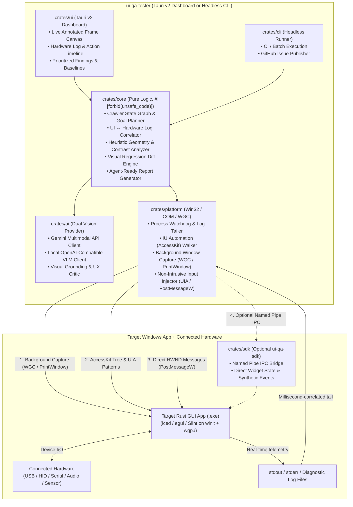

# 03 — Architecture

> Status: **APPROVED**. 🔬 = must be confirmed by a Milestone 0 spike.

## Tech stack (see [`decisions/0001-rust-tauri-v2-uia-wgc-architecture.md`](decisions/0001-rust-tauri-v2-uia-wgc-architecture.md))
| Concern | Choice |
|---|---|
| Language / runtime | **Rust (2021 edition, stable `x86_64-pc-windows-msvc`)** |
| Windows OS & Capture APIs | **`windows` crate v0.58+** (`UI::Accessibility` / `IUIAutomation`, `Graphics::Capture`, `Win32::Graphics::Gdi`, `Win32::UI::WindowsAndMessaging`, `Win32::System::JobObjects`) |
| Live QA Dashboard UI | **Tauri v2** (Rust backend commands/events + lightweight HTML5/CSS/TypeScript frontend with interactive `<canvas>` bounding-box overlay) |
| Image processing & Diffing | **`image` + `imageproc`** (pure Rust RGBA buffer manipulation, perceptual hashing, SSIM/pixel diff, bounding-box annotation) |
| AI Vision & Planning Backend | **Dual-provider HTTP (`reqwest` + `serde_json`)**: Google Gemini Multimodal API (`gemini-2.5-flash` / `gemini-2.5-pro`) and OpenAI-compatible Vision endpoint (Ollama / LM Studio / vLLM) |
| Config / Reports / Storage | **TOML** (`qa-session.toml`), **JSON** (`report.json`, baseline index), **Markdown** (`report.md`) |
| i18n | JSON catalogs (`locales/en.json`, `locales/it.json`) shared across CLI and Dashboard UI |
| Build / CI | Cargo workspace + GitHub Actions (`windows-latest`) |

## Component / process model


## Module boundaries (designed for parallel work)
```text
ui_qa_tester/
├── Cargo.toml               # Workspace root & single source of version truth
├── rust-toolchain.toml      # Pinned stable x86_64-pc-windows-msvc + clippy + rustfmt
├── locales/                 # Shared i18n dictionaries (en.json, it.json)
├── crates/
│   ├── core/                # Pure logic (#![forbid(unsafe_code)]), zero OS/network deps, 100% unit-tested
│   ├── platform/            # Windows OS integration (UIA, WGC, PrintWindow, HWND input, process watchdog)
│   ├── ai/                  # Gemini API & local OpenAI-compatible Vision LLM client (#![forbid(unsafe_code)])
│   ├── sdk/                 # Optional lightweight hook crate for target egui/iced/Slint apps (#![forbid(unsafe_code)])
│   ├── cli/                 # Headless CLI runner & GitHub Issue exporter (#![forbid(unsafe_code)])
│   ├── ui/                  # Tauri v2 desktop dashboard (Rust backend + webview frontend assets)
│   └── probe/               # M0 diagnostic probe for WGC/PrintWindow capture & UIA/PostMessageW verification
└── scripts/                 # Packaging, manifest generation, and setup scripts
```
**Rule:** Independent roadmap tasks touch disjoint crates so multiple `project-worker` subagents can execute in parallel without merge conflicts.

## Key technical designs

### 1. Non-Intrusive Background Window Capture (`crates/platform`) 🔬
- **Mechanism:** Uses `Windows.Graphics.Capture` (`IGraphicsCaptureItemInterop::CreateForWindow`) as the primary capture pipeline for `wgpu` / DirectX 11/12 / Vulkan surfaces rendered by `egui`, `iced`, and `Slint`. It copies the DWM texture into a staging `ID3D11Texture2D` with CPU read access (`D3D11_CPU_ACCESS_READ`) and maps it into an `image::RgbaImage` within `≤ 50 ms` (NFR-P1).
- **Fallback 🔬:** `PrintWindow(hwnd, hdc, PW_RENDERFULLCONTENT)` (`0x00000002`) is implemented as a synchronous GDI fallback and benchmarked against WGC in **M0.2**.
- **Occlusion Invariant:** Both WGC and `PrintWindow(PW_RENDERFULLCONTENT)` read the window's DWM composition surface directly, so the target window can remain behind the developer's IDE or on a secondary monitor without ever stealing focus. (Note: Windows DWM pauses rendering for *minimized* windows, so `crates/platform` ensures the target `HWND` stays in `SW_SHOWNOACTIVATE` state rather than `SW_MINIMIZE`).

### 2. Three-Tier Non-Intrusive Input & Inspection for `iced`, `egui`, and `Slint` (`crates/platform` + `crates/sdk`) 🔬
- **Inspection:**
  1. **AccessKit / UIA Tree:** Queries `IUIAutomation::ElementFromHandle(hwnd)` and walks descendants using `IUIAutomationTreeWalker` with a bulk `IUIAutomationCacheRequest` (fetching `Name`, `AutomationId`, `ControlType`, `IsEnabled`, `IsOffscreen`, `BoundingRectangle`, and supported pattern availability in a single cross-process COM call to satisfy NFR-P2 `≤ 40 ms`).
  2. **Vision Grounding Fallback:** When a custom canvas or un-annotated `iced` widget is missing from the UIA tree, `crates/ai` asks the Vision LLM to return normalized `[ymin, xmin, ymax, xmax]` coordinates (`0..1000`) for interactive elements visible in the captured frame, converting them to client-relative pixel rects.
- **Input Dispatch (Without Stealing Focus):**
  1. **Tier 1 — UIA Control Patterns:** If the target element exposes `InvokePattern`, `TogglePattern`, `ValuePattern`, or `SelectionItemPattern`, invoke it via COM directly. Zero cursor movement, zero focus change.
  2. **Tier 2 — Direct `HWND` Message Queue (`PostMessageW`) 🔬:** Computes `lparam = MAKELPARAM(client_x, client_y)` and posts `WM_MOUSEMOVE`, followed by `WM_LBUTTONDOWN` (`MK_LBUTTON`) and `WM_LBUTTONUP` directly to the target `HWND`. For keyboard input, posts `WM_KEYDOWN` / `WM_CHAR` / `WM_KEYUP`.
  3. **Tier 3 — `ui-qa-sdk` Named Pipe Bridge:** For target Rust GUI apps compiled with the optional `ui-qa-sdk` crate, sends a structured JSON command (`Click { x, y }`, `KeyPress { key }`, `SetWidgetValue { id, value }`) over `\\.\pipe\ui-qa-tester-<pid>`, which the target app injects directly into its `egui::RawInput`, `iced::runtime::Action`, or `slint::Window::dispatch_event` queue.
  4. **Fallback 🔬 (verified in M0.3):** If a black-box `winit` target ignores unfocused `WM_LBUTTONDOWN` because it checks `GetFocus()` or uses `WM_INPUT`, the runner offers an opt-in **Secondary Win32 Desktop (`CreateDesktopW`)** or **Idle Micro-Focus mode** (waits until user mouse/keyboard is idle, saves foreground `HWND` + cursor pos, performs the click in `< 10 ms`, and restores cursor + foreground window).

### 3. Real-Time UI Action ↔ Hardware Log Correlation Engine (`crates/core`)
- Before executing any UI action $a_i$ at timestamp $t_{\text{start}}$, the engine records a log bookmark $(t_{\text{start}} - 50\text{ ms})$.
- After dispatching $a_i$, the engine observes `stdout`, `stderr`, and tailed log files for a configurable settle window (default `500 ms`, extendable up to `2000 ms` if hardware commands are pending) while checking process health (`CPU`, `RAM`, `IsHungAppWindow`).
- Every log line emitted in $[t_{\text{start}} - 50\text{ ms}, t_{\text{settle}}]$ is attached to transition edge $e_i$ and classified by configurable rules:
  - **Hardware Success Signals:** e.g. `ACK`, `Connected`, `Frame synced`, `Calibration complete`.
  - **Hardware / App Fault Signals:** e.g. `NACK`, `SerialError`, `USB disconnect`, `TimedOut`, `thread '...' panicked`, `ERROR`.
- If a UI button visually toggles to "Connected" while `stderr` logs `SerialError: Access denied`, the correlator flags a **High-Severity Silent Hardware Mismatch Defect** (UI state contradicts hardware telemetry).

### 4. Dual-Layer Visual & UX Critique (`crates/core` + `crates/ai`)
- **Layer 1 — Deterministic Fast Heuristics (`crates/core`, `< 5 ms`, zero API cost):**
  - Detects overlapping sibling `BoundingRectangle` nodes in UIA.
  - Detects controls extending outside the client window bounds (clipped controls).
  - Detects interactive controls (`Button`, `Slider`, `CheckBox`, `Edit`) with empty `Name` and no `AutomationId` (Accessibility / AccessKit defect).
  - Measures WCAG relative luminance contrast ratio around text bounding boxes.
- **Layer 2 — Multimodal AI Critic (`crates/ai`, Gemini API or Local VLM):**
  - Sends the composite package (raw screenshot + UIA bounding-box overlay + UIA tree summary + correlated hardware logs) with a structured JSON output schema (`CritiqueResponse`).
  - Produces categorized findings (`VisualBug`, `HardwareMismatch`, `UxFriction`, `Accessibility`, `ImprovementSuggestion`) with severity, exact `[x, y, w, h]` coordinates, user impact explanation, and a concrete **Rust GUI (`iced`/`egui`/`Slint`) fix recommendation**.

## Rejected alternatives
- **Playwright / WebDriver only:** Rejected because `iced`, `egui`, and `Slint` render directly to GPU surfaces (`wgpu` / DirectX / OpenGL) via `winit` and have no HTML DOM.
- **DLL Injection / Detours into `wgpu`/`dxgi.dll`:** Rejected because injecting DLLs into target processes triggers Windows Defender / EDR blocks and can destabilize target apps during hardware testing.
- **Global `SendInput` as primary input mechanism:** Rejected because `SendInput` hijacks the developer's physical mouse cursor and active window focus, making it impossible to use the workstation while QA runs.

## Known limitations
- **Minimized windows on Windows DWM:** Windows Desktop Window Manager stops updating the GPU surface of minimized (`SW_MINIMIZE`) windows. Target windows must remain in a restored/normal state (`SW_SHOWNOACTIVATE`)—they can be completely covered by other windows or placed on a secondary/virtual monitor, just not minimized to the taskbar.
