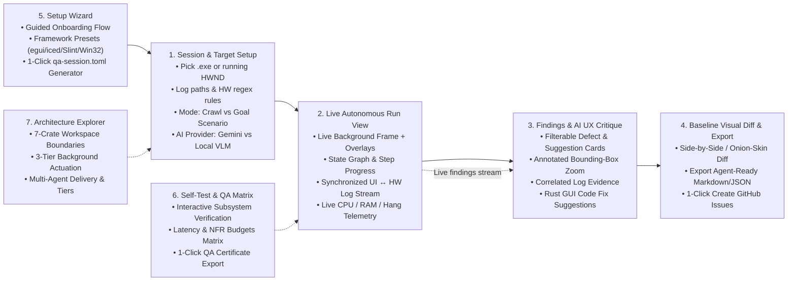

# 04 — UX

> Status: **APPROVED**

## Entry points
1. **Live QA Dashboard (`ui-qa-ui.exe` — Tauri v2 Desktop App):** Interactive control center for configuring target apps, watching hands-free QA runs in real time, inspecting annotated screenshots and correlated hardware logs, comparing visual baselines, and exporting reports or GitHub Issues.
2. **Headless CLI (`ui-qa-cli.exe`):** Scriptable command-line runner for CI pipelines, automated overnight soak runs, or invocation by AI coding agents (`ui-qa-cli run --config qa-session.toml --export ./qa-out`).
3. **M0 Diagnostic Probe (`ui-qa-probe.exe`):** Standalone CLI utility for testing background window capture and UIA/message dispatch against any target `.exe` or `HWND`.

## Screens & flows (Tauri v2 Live QA Dashboard)

### 1. **Session & Target Setup View**
- **Purpose:** Configure what to test, how to monitor connected hardware logs, and which AI backend to use.
- **Main controls:**
  - **Target Selector:** Browse for `.exe` binary (with CLI args & working dir) OR pick from a live dropdown of running Windows processes/windows (highlighting detected `egui`, `iced`, `Slint`, and `winit` windows).
  - **Hardware & Log Telemetry Panel:** Toggle `stdout`/`stderr` capture, add diagnostic log file paths to tail, and configure regex patterns for *Hardware OK* vs *Hardware Error/Timeout*.
  - **Execution Mode:**
    - *Autonomous UI Crawler* (max steps, max depth, destructive-button blocklist regex).
    - *Goal-Driven Scenario* (multi-step plain-English prompt editor or load from `.toml`).
  - **Focus Mode:** `Background (Non-Intrusive — Default)` vs `Isolated Desktop / Micro-Focus Fallback`.
  - **AI Vision Provider:** Select `Google Gemini API` (model selector + env key check indicator) or `Local OpenAI-Compatible VLM` (URL input e.g. `http://localhost:11434/v1` + model name + connection test button).
- **States:**
  - *Empty:* Quick-start presets for `egui`, `iced`, and `Slint` targets.
  - *Ready:* Green indicator confirming target `.exe` exists (or `HWND` is valid) and AI provider is reachable (or heuristics-only mode enabled).
  - *Error:* Clear inline banner if target path is invalid or log file cannot be read.

### 2. **Live Autonomous Run View**
- **Purpose:** Watch the QA agent explore and test the target app hands-free without touching the target window.
- **Main controls & panels:**
  - **Live Annotated Canvas (Left/Center):** Displays the latest background-captured frame of the target app with toggleable overlays:
    - Blue boxes: discovered AccessKit / UIA controls.
    - Purple boxes: Vision-grounded controls.
    - Green pulse: control currently being actuated.
    - Red/Amber boxes: detected visual or UX anomalies on the current screen.
  - **Synchronized Action ↔ Hardware Log Timeline (Bottom):** Split stream showing `[Step #14] Clicked Button 'Calibrate Sensor' (x=340, y=120)` immediately followed by the correlated `stdout`/`stderr`/log lines emitted during that step's settle window.
  - **Process Health Strip (Top Bar):** Real-time badges for target PID, FPS/capture latency, RAM (`MB`), CPU (`%`), Window Status (`Responsive` / `Hung`), and Pause / Resume / Stop buttons.

### 3. **Findings & AI UX Critique View**
- **Purpose:** Review discovered bugs, silent hardware errors, visual layout defects, and AI UX improvement suggestions.
- **Main controls:**
  - **Severity & Category Filter Bar:** Filter by `Critical`, `High`, `Medium`, `UX Suggestion`, and by source (`Hardware/Log Mismatch`, `Visual Layout`, `UX Critique`, `Accessibility / AccessKit`, `Crash / Hang`).
  - **Finding Detail Inspector:** Selecting any finding displays:
    1. Annotated screenshot zoomed to the defect bounding box alongside the full window frame.
    2. Exact reproduction path (`Launch -> Click 'Settings' -> Toggle 'High Speed Mode'`).
    3. Correlated hardware log snippet (`stderr` / log file lines around the event).
    4. **AI Improvement Suggestion:** Concrete UX rationale and suggested Rust (`iced`/`egui`/`Slint`) layout or state-handling improvement.

### 4. **Baseline Visual Diff & Export View**
- **Purpose:** Compare screens against a previous known-good build and export results for coding agents or GitHub.
- **Main controls:**
  - **Baseline Comparator:** Side-by-side, swipe, and pixel-diff heatmap views comparing current screen states against a saved baseline directory, showing SSIM score and changed bounding boxes.
  - **Save as Baseline:** Pin current session screenshots as the new golden baseline.
  - **Export Bar:**
    - *Copy Agent Prompt to Clipboard:* Copies a structured prompt + file links ready to paste into Antigravity / Claude / Cursor to fix the selected findings automatically.
    - *Export Bundle (`report.md` + `report.json` + `screenshots/`).*
    - *Create GitHub Issues:* Preview and publish selected findings to the target repo via `gh` CLI / GitHub API.

## First-run / onboarding
- On first launch, the dashboard checks:
  1. Target window capture permissions (verifies `Windows.Graphics.Capture` support on the host Windows version).
  2. AI backend configuration (checks if `GEMINI_API_KEY` is set in the environment or if a local Ollama/LM Studio server is listening on localhost; always allows running in **Local Deterministic Heuristics + Crawler mode** even without an LLM key).
  3. Offers a 1-click **"Run Self-Test Demo"** against a built-in dummy test window so the user can immediately see background capture, non-intrusive clicking, and report generation in action.

## Behaviour rules
- **Zero Focus Stealing:** Interacting with the QA Dashboard never forces the target application to the foreground unless the user explicitly clicks *"Bring Target Window to Front"*.
- **Accessibility:** Full keyboard navigation (`Tab`, `Enter`, `Space`, `Esc`), dark/light high-contrast theme (`≥ 4.5:1` WCAG AA contrast), and DPI-aware scaling (`100%`–`250%`).
- **Localization:** English (`en`) and Italian (`it`) included at launch via `locales/en.json` and `locales/it.json`; switching language in the header updates all UI labels immediately without restarting.
