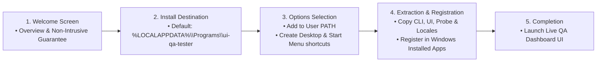
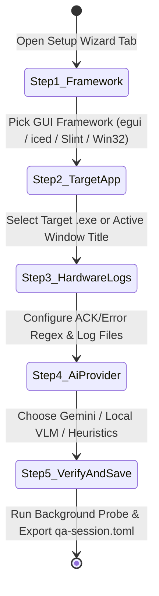

# 07 — UX Improvements & Product Evolution Specification

This document outlines the design and technical specifications for **`ui-qa-tester`** user experience enhancements, including the **Guided Windows Setup Wizard**, **First-Run Onboarding Configuration Wizard**, **Interactive Self-Test & QA Verification Matrix**, **Didactic Architecture Explorer**, and **Responsive Live Dashboard Layout**.

---

## 1. Guided Windows Setup Wizard (`scripts/setup-wizard.ps1` & `scripts/installer.iss`)

### Objective
Provide a zero-elevation graphical Windows Forms installer wizard (`setup.cmd` / `setup-wizard.ps1`) and Inno Setup script (`installer.iss`) suitable for both interactive developers and automated CI environments.

### Technical Specification
- **Zero Administrator Elevation Required:** Installs cleanly into `%LOCALAPPDATA%\Programs\ui-qa-tester` without triggering UAC prompts.
- **Windows Settings ("Installed apps") Integration:** Writes registry metadata to `HKCU\Software\Microsoft\Windows\CurrentVersion\Uninstall\UiQaTester` (`DisplayName`, `DisplayVersion`, `Publisher`, `UninstallString`, `QuietUninstallString`).
- **Multi-Mode Support:** Supports Graphical Windows Forms Wizard (default), interactive console wizard (`-NoGui`), and zero-touch silent automation (`-Silent`).

---

## 2. First-Run Onboarding Configuration Wizard (`🪄 Setup Wizard` Tab in `ui-qa-ui`)

### Objective
Guide developers through configuring a new target application (`iced`, `egui`, `Slint`, or native Win32), hardware telemetry patterns, and AI Vision provider from inside the Live QA Dashboard, generating a ready-to-run `qa-session.toml` in seconds.

### Step-by-Step Wizard Architecture
1. **Step 1 — Target GUI Framework Preset:**
   - Pre-populates optimal `AccessKit` / UIA depth and destructive control blocklists for **`egui` / `eframe`** (e.g., `MagicBridge`), **`iced`**, **`Slint`**, or **Win32 / Tauri**.
2. **Step 2 — Target Executable & Window Binding:**
   - Live window picker (`Refresh Windows`) or file path input for `target_exe` + `target_window_title`, with strict `focus_mode = "background"` lock.
3. **Step 3 — Hardware Telemetry & Log Correlation:**
   - Presets for Serial/COM (`ACK`/`NACK`), USB/Bluetooth HID (`0xFF00`, report `0x90`), and Named Pipe IPC, plus custom log file tailing.
4. **Step 4 — AI Vision Critic Provider:**
   - Switch between **Google Gemini (`gemini-2.5-flash`)**, **Local OpenAI-Compatible VLM (`Ollama` / `LM Studio`)**, or **100% Offline Deterministic Heuristics**.
5. **Step 5 — Live Background Probe & `qa-session.toml` Generator:**
   - Runs a 1-click non-intrusive verification check and populates/exports the complete `qa-session.toml` configuration.

---

## 3. Interactive Self-Test & QA Verification Matrix (`🧪 Self-Test & QA` Tab)

### Objective
Provide an interactive, in-app diagnostic verification matrix modeled after `MagicBridge`'s Hardware QA tab (`qa_view.rs`), allowing users to empirically verify all 4 core subsystems of `ui-qa-tester` on their Windows machine and export a JSON/Markdown verification certificate.

- **Subsystems Verified Live:**
  1. **Background Window Capture (`PrintWindow`):** Verifies `p95 ≤ 50 ms` capture latency on an offscreen/background window without focus stealing.
  2. **`AccessKit` / UIA Tree Walker:** Verifies depth-5 `IUIAutomation` extraction (`≤ 40 ms`) with `TitleBar` (`50037`) MSAA proxy filtering.
  3. **Non-Intrusive Background Actuation (`PostMessageW`):** Verifies client-coordinate click injection while `GetForegroundWindow()` remains unchanged.
  4. **Hardware Log Correlator & Vision Heuristics:** Verifies `< 2 ms / 1,000 lines` correlation throughput and overlap/clipping/accessibility detection.
- **Visual Feedback:** Verified rows turn bright green (`#2ECC71`) with empirical latency metrics and a one-click **Export QA Verification Report** button.

---

## 4. Didactic Architecture Explorer (`🤖 Architecture` Tab)

### Objective
Embed an interactive multi-section architecture and multi-agent methodology explorer directly inside `ui-qa-ui` (matching `MagicBridge`'s `architecture_view.rs`), covering:
- **System Overview & Non-Intrusive Guarantee**
- **3-Tier Background Actuation (`AccessKit` UIA → `PostMessageW` → `ui-qa-sdk`)**
- **7-Crate Cargo Workspace Boundaries (`#![forbid(unsafe_code)]`)**
- **Hub-and-Spoke Multi-Agent Delivery & Complexity Tiers (`T1`/`T2`/`T3`)**

---

## 5. Fluid Responsive Dashboard Layout (`< 850px` Compact vs `>= 850px` Expanded)

### Objective
Ensure `ui-qa-ui` adapts smoothly across compact side-by-side developer splits (`< 850px` width) and full-screen 1080p/4K monitors (`>= 850px` width) with zero horizontal clipping:
- **Adaptive Navigation Rail:** Automatically switches to compact icon-first scrollable tabs below `850px` and full icon + localized label tabs at `>= 850px`.
- **Responsive Split Grids:** Collapses 2-column and 3-column dashboard grids into vertical stacks on narrow viewports so side-by-side coding + QA monitoring never overflows.
