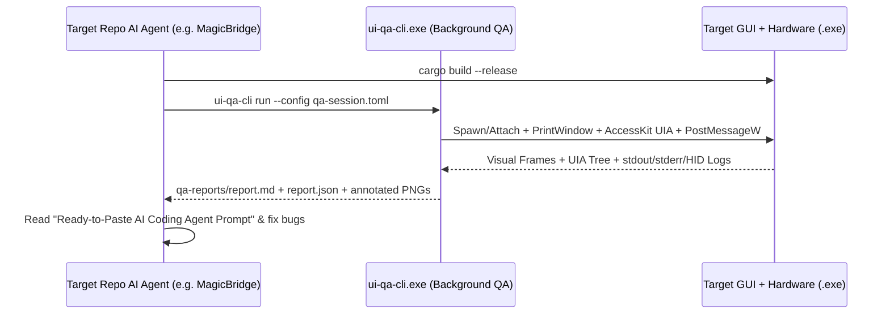

# 08 — Community, Ecosystem & Multi-Framework Growth Strategy

This document defines the distribution strategy, AI coding agent ecosystem integration, and multi-framework expansion roadmap for **`ui-qa-tester`**.

---

## 1. Frictionless Windows Distribution Channels

1. **Microsoft WinGet (`DooperDrew.UiQaTester`):**
   - Multi-file manifest (`version`, `installer`, `defaultLocale`) under [`packaging/winget/manifests/d/DooperDrew/UiQaTester/`](../packaging/winget/).
   - Allows any Windows developer or CI runner to install via `winget install DooperDrew.UiQaTester`.
2. **Scoop Package Manager (`ui-qa-tester.json`):**
   - Manifest at [`packaging/scoop/ui-qa-tester.json`](../packaging/scoop/ui-qa-tester.json) exposing `ui-qa-cli`, `ui-qa-ui`, and `ui-qa-probe` shims on `$env:PATH`.
3. **Zero-Elevation Graphical Setup Wizard (`setup.cmd` / `setup-wizard.ps1`):**
   - Bundled inside every GitHub Release `.zip` archive so users can install with a double-click without administrator privileges.
4. **Portable Release Archive (`.zip`):**
   - Self-contained archive (`ui-qa-tester-v<version>-windows-x64.zip`) with pre-built binaries, locales, and starter examples (including [`examples/magicbridge-qa-session.toml`](../examples/magicbridge-qa-session.toml)).

---

## 2. AI Coding Agent Integration Playbook

`ui-qa-tester` is built specifically to serve as the **eyes and hands** of autonomous coding agents (Antigravity, GitHub Copilot Agent, Claude Code, Cursor) working on Windows desktop and Hardware-in-the-Loop repositories:

---

## 3. Multi-Framework Expansion Roadmap

| Phase | Target GUI / Hardware Stack | Status | Key Integration Mechanism |
|---|---|---|---|
| **Phase 1 (v0.1–v0.2)** | **`egui` / `eframe`** (e.g., [`MagicBridge`](https://github.com/DooperDrew/magicbridge)) | ✅ **Verified Live** | Depth-5 `AccessKit` UIA tree walker + `window_rel_to_client_coords` `PostMessageW` + HID/IPC log correlation |
| **Phase 2 (v0.2)** | **`iced` & `Slint` (Rust Native GUIs)** | ✅ **Supported** | `AccessKit` (`iced`) / `Accessible` (`Slint`) UIA patterns + `PrintWindow(PW_RENDERFULLCONTENT)` |
| **Phase 3 (v0.3+)** | **Tauri v2 / WebView2 & WinUI 3** | 🗓️ **Planned** | Deep WebView2 UIA subtree traversal + multi-window child HWND tracking |
| **Phase 4 (v0.4+)** | **Qt6 / C++ & Flutter Windows** | 🗓️ **Planned** | MSAA / UIA bridge normalization + high-DPI per-monitor coordinate scaling |
