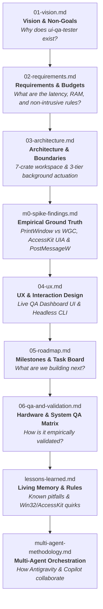

# ui-qa-tester Documentation System

This directory contains the canonical specifications, empirical spike findings, architectural blueprints, and living governance logs for **`ui-qa-tester`**.

In an agent-assisted and autonomous engineering environment, **the codebase specifications are the primary interface between human intent and AI execution**. Keeping technical truth in version-controlled markdown files prevents context drift, hallucinated constraints, architectural fragmentation, and abandoned conventions.

---

## 📚 Specification Hierarchy & Reading Order

Whenever an agent or human developer enters the repository, documents must be consulted in this exact sequence before any code is generated or modified:

---

## 🗂️ Document Inventory

| File | Purpose | Key Content & Conventions |
|---|---|---|
| [`01-vision.md`](01-vision.md) | **North Star** | Core problem statement, non-goals, guiding principles, and target Rust GUI frameworks (`iced`, `egui`, `Slint`). |
| [`02-requirements.md`](02-requirements.md) | **Functional & NFR Specs** | MoSCoW-prioritized features (`F1`–`F10`), strict quantitative budgets (`NFR-P1`..`P5`: ≤50ms capture, ≤80MB idle RAM, <2ms log correlation), and non-intrusive focus rules (`NFR-S1`). |
| [`03-architecture.md`](03-architecture.md) | **Structural Blueprint** | 7-crate Cargo workspace (`core`, `platform`, `ai`, `sdk`, `cli`, `ui`, `probe`), 3-tier background actuation, and observe-correlate-critique-act loop. |
| [`04-ux.md`](04-ux.md) | **Dashboard & CLI Specs** | Live QA Dashboard views, onboarding wizard, interactive self-test matrix, architecture explorer, and CLI commands. |
| [`05-roadmap.md`](05-roadmap.md) | **Single Source of Truth for Tasks** | Phased milestones (`M0` through `M9`). Checked off with date and git commit upon verification. |
| [`06-qa-and-validation.md`](06-qa-and-validation.md) | **Empirical Proof & Test Matrices** | Automated NFR verification suite, soak tests, real-world `MagicBridge` (`egui` 0.31) validation, and physical HIL QA matrix. |
| [`07-ux-and-improvements.md`](07-ux-and-improvements.md) | **User Experience & Onboarding** | Guided Windows Setup Wizard, First-Run Onboarding Wizard, Responsive Dashboard UI, Interactive Self-Test Matrix, and Architecture Explorer. |
| [`08-community-and-growth-strategy.md`](08-community-and-growth-strategy.md) | **Ecosystem & Community** | WinGet/Scoop distribution channels, AI agent integration playbooks, and multi-framework expansion roadmap. |
| [`m0-spike-findings.md`](m0-spike-findings.md) | **Win32 & UIA Ground Truth** | Verified M0 discoveries: `PrintWindow(PW_RENDERFULLCONTENT)` 10.67 ms background capture, UIA `TitleBar` (`50037`) proxy filtering, and `PostMessageW` client coordinate mapping. |
| [`lessons-learned.md`](lessons-learned.md) | **Living Memory & Rules Engine** | Feedback log turning empirical debugging insights and Win32/AccessKit quirks into enforceable engineering rules. |
| [`retrospective.md`](retrospective.md) | **Project Retrospective** | Comprehensive retrospective mining git history and engineering decisions across `M0`–`v0.2.0`. |
| [`multi-agent-methodology.md`](multi-agent-methodology.md) | **Multi-Agent Orchestration** | Hub-and-Spoke Lead/Worker model, Sole Committer Protocol, complexity tiers, GitHub Copilot cloud agent integration, and Draft PR workflows. |
| [`model-fallback-log.md`](model-fallback-log.md) | **Model Routing & Quota Audit** | Audit log tracking tasks run on fallback or lower-tier models. |
| [`release-methodology.md`](release-methodology.md) | **Release Engineering** | SemVer definitions, single source of version truth, release checklist, tagging procedure, and GitHub release automation. |
| [`user-guide.md`](user-guide.md) | **End-User Documentation** | Complete manual covering multi-channel installation (WinGet, Scoop, Setup Wizard, Portable ZIP), `qa-session.toml`, CLI automation, and Live Dashboard usage. |
| [`decisions/`](decisions/) | **Architecture Decision Records (ADR)** | Records capturing context, options considered, and architectural rationale. |

---

## 🔬 Core Working Agreements

1. **Claims Follow Evidence:** Never mark physical hardware tests as passed without empirical evidence. Automated invariant and self-test benchmarks are marked `PASS`; physical multi-board HIL rows in `06-qa-and-validation.md` remain marked **`[Pending Physical Confirmation]`**.
2. **Knowledge Lives in the Repo, Not in Chats:** Any architectural decision, lesson learned, or empirical finding that should outlive the conversation session must be written to a file in `docs/` or `CHANGELOG.md` before the turn ends.
3. **Sole Committer Protocol:** Only the Lead Orchestrator agent interacting with the user may execute `git commit`, `git push`, edit remotes, or close GitHub issues. Worker subagents and cloud agents operate strictly on branches or draft pull requests.
