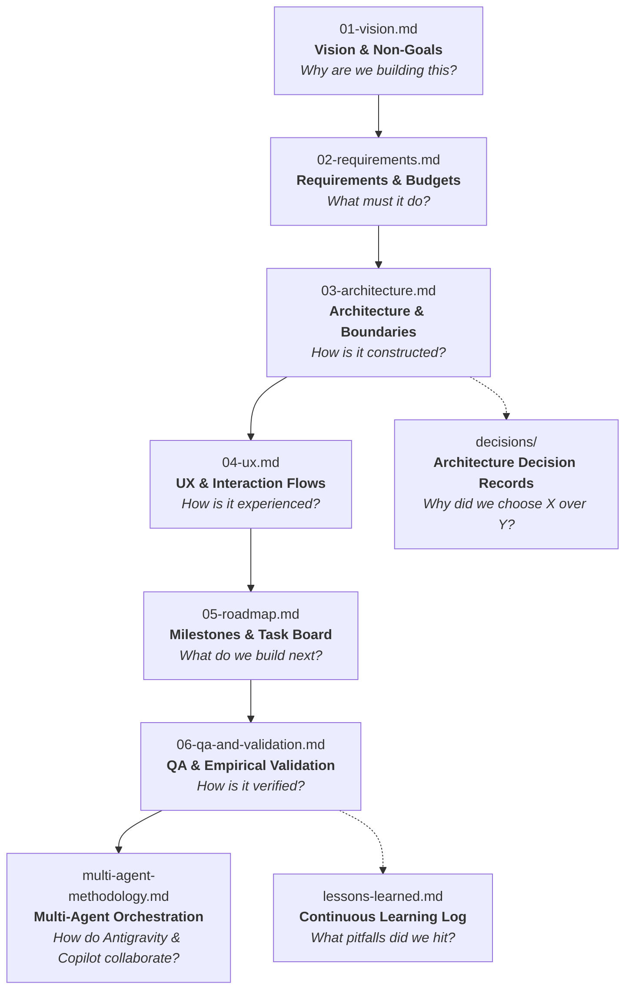

# Project Kickstart Documentation System — ui-qa-tester

This directory contains the specification and governance documents that define the lifecycle of **ui-qa-tester**, built with the **Project Kickstart** methodology.

In an agent-assisted or autonomous engineering environment, **the codebase specifications are the primary interface between human intent and AI execution**. Keeping technical truth in version-controlled markdown files prevents context drift, hallucinated constraints, architectural fragmentation, and abandoned conventions.

---

## 📚 Specification Hierarchy & Reading Order

Whenever an agent or developer enters the workspace, documents must be consulted in this exact sequence before any code is generated or modified:

---

## 🗂️ Document Inventory

| File | Purpose | Key Content & Conventions |
|---|---|---|
| [`01-vision.md`](01-vision.md) | **North Star** | Problem statement, targeted user personas, core guiding principles in priority order, and explicit non-goals. |
| [`02-requirements.md`](02-requirements.md) | **Functional & Non-Functional Specs** | MoSCoW-prioritized features (`F1`–`F8`), quantitative non-functional budgets (`NFR-P1`–`NFR-P5`), and safety requirements. |
| [`03-architecture.md`](03-architecture.md) | **Structural Blueprint** | Tech stack selection, Mermaid component diagrams, directory boundaries designed for parallel agent execution, and key designs. |
| [`04-ux.md`](04-ux.md) | **Interaction Model** | Tauri v2 Live QA Dashboard screens, CLI flags, state flows, keyboard shortcuts, accessibility, and i18n rules. |
| [`05-roadmap.md`](05-roadmap.md) | **Single Source of Truth for Work** | Phased milestones (M0 through M7). Parallel tasks marked with `⇉`. Checked off with date and git commit ID upon verification. |
| [`06-qa-and-validation.md`](06-qa-and-validation.md) | **Empirical Proof & Test Matrices** | Empirical measurements of NFR budgets, real-environment hardware/manual QA matrices, edge case regressions, and incident reporting. |
| [`multi-agent-methodology.md`](multi-agent-methodology.md) | **Parallel & Cloud Agent Orchestration** | Hub-and-Spoke model, Sole Committer Protocol, complexity tiers, GitHub Copilot cloud agent integration, and Draft PR workflows. |
| [`decisions/`](decisions/) | **Architecture Decision Records (ADR)** | Lightweight records using [`0000-template.md`](decisions/0000-template.md) capturing context, choices considered, and rationale. |
| [`lessons-learned.md`](lessons-learned.md) | **Living Memory & Rules Engine** | Feedback log turning user corrections and debugging insights into enforceable engineering rules. Generic rules tagged `[KIT]` feed back into upstream tooling. |
| [`model-fallback-log.md`](model-fallback-log.md) | **Model Routing & Quota Audit** | Audit log tracking tasks run on fallback or lower-tier models, creating mandatory review items during M5 hardening. |
| [`release-methodology.md`](release-methodology.md) | **Release Engineering** | SemVer definitions, single source of version truth, release checklist, tagging procedure, and GitHub release automation. |
