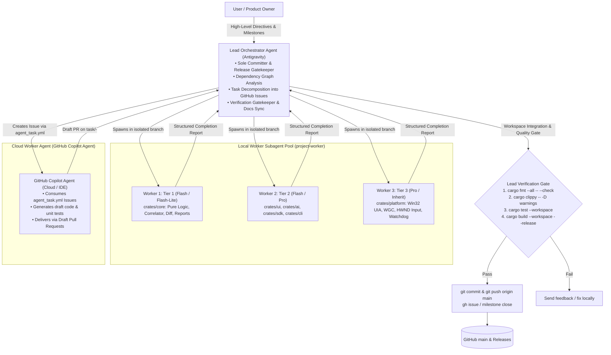

# Multi-Agent Parallel Architecture & Methodology Guide

> **Audience:** AI Engineers, System Architects, Open-Source Contributors, and Autonomous Agents.  
> **Status:** Canonical Methodology Guide.  
> **Repository:** `https://github.com/DooperDrew/ui-qa-tester`

---

## 1. Executive Summary & Philosophy

When building complex software systems with autonomous AI coding agents, engineering teams typically face two major bottlenecks:
1. **Context Window Exhaustion & Cognitive Drift:** A single agent attempting to hold the entire system architecture, UI state, low-level platform APIs, and build scripts simultaneously exhausts its context window, leading to forgotten constraints, hallucinations, and regression bugs.
2. **Sequential Latency & Token Inefficiency:** Running boilerplate generation or docs updates on large, slow, high-reasoning models wastes tokens and time, while using small models on safety-critical, concurrent, or performance-sensitive paths introduces severe bugs.

This repository implements a production-grade **Hub-and-Spoke (Lead Orchestrator & Parallel Worker)** architecture. By decomposing projects into **strictly bounded, disjoint work packages** and orchestrating multi-tiered AI models across local branch worktrees and cloud agent workers, teams achieve rapid parallel development with **zero git merge collisions, deterministic verification gates, and complete traceability**.



---

## 2. Dynamic Model Selection & Complexity Tiers

To maximize token efficiency without sacrificing code safety or accuracy, tasks are categorized into three distinct complexity tiers:

| Tier | Workload Scope | Architectural Criteria | Target Model | Token Cost Optimization |
|---|---|---|---|---|
| **Tier 1 (T1 — Lean)** | Pure business logic (`crates/core`), data schemas, serialization, unit tests, i18n dictionaries, packaging scripts, docs. | • Pure deterministic logic (`#![forbid(unsafe_code)]`).<br>• Isolated from OS dependencies.<br>• High test coverage. | **`flash`** or **`flash_lite`** | **~80–90% reduction** in token expenditure; high velocity. |
| **Tier 2 (T2 — Moderate)** | Tauri v2 UI components (`crates/ui`), AI HTTP client (`crates/ai`), SDK IPC (`crates/sdk`), CLI (`crates/cli`). | • UI rendering & state management.<br>• Standard async HTTP / IPC.<br>• `#![forbid(unsafe_code)]`. | **`flash`** or **`pro`** (task-dependent) | Balanced reasoning and throughput. |
| **Tier 3 (T3 — Complex / Critical)** | Win32 COM (`IUIAutomation`), `Windows.Graphics.Capture`, `PostMessageW` input injection, process Job Objects & watchdog (`crates/platform`). | • Low-latency capture (`≤ 50 ms`).<br>• COM STA/MTA safety & handle lifetimes.<br>• Documented `// SAFETY:` invariants. | **`pro`** or **`inherit`** | Deepest reasoning, strict memory/handle safety. |

### Fallback & Retrospective Audit Loop
If rate limits or quota exhaustion make a higher-tier model temporarily unavailable:
1. **Deterministic Fallback Order:** `inherit` → `pro` → `flash` → `flash_lite`.
2. **Mandatory Logging:** The Lead Agent immediately logs the incident into [`docs/model-fallback-log.md`](model-fallback-log.md).
3. **Audit Task Scheduling:** A review task is automatically created in [`docs/05-roadmap.md`](05-roadmap.md) under Milestone 5 (Hardening) to re-verify the implementation with a flagship model once tokens are restored.

---

## 3. The Sole Committer Protocol & Workspace Isolation

In a multi-agent environment, having multiple agents write directly to the same branch or repository root inevitably causes file corruption, race conditions, and broken builds.

### Protocol Invariants:
1. **Single Committer:** Only the Lead Agent (the interactive Antigravity session with the user) is authorized to run `git commit`, `git push`, edit git remotes, or close GitHub issues.
2. **Local Worktree Isolation:** Worker subagents run in isolated workspace branches (via `Workspace: "branch"`). They touch only the files assigned to their ownership boundary.
3. **Zero Direct Main Commits:** Worker subagents and cloud agents are strictly forbidden from committing directly to `main` or merging pull requests.
4. **Disjoint File Ownership:** Parallel tasks must operate on disjoint crates/files. Cross-module dependencies are resolved sequentially or behind stable traits in `crates/core`.

---

## 4. Cloud Multi-Agent Collaboration: GitHub Copilot Agent Integration

In addition to local Antigravity subagents, this repository provides a first-class workflow for **GitHub Copilot Agent** in GitHub Cloud or IDE.

### Configuration Guardrails:
1. [`.github/copilot-instructions.md`](../.github/copilot-instructions.md): Permanent instructions for Copilot establishing the Sole Committer Protocol, modular boundaries, and performance budgets.
2. [`.github/ISSUE_TEMPLATE/agent_task.yml`](../.github/ISSUE_TEMPLATE/agent_task.yml): Structured issue template defining task objectives, complexity tiers, file ownership boundaries, and verifiable acceptance criteria.
3. **Draft PR Pattern:** Copilot delivers all changes as Draft Pull Requests, ensuring zero unreviewed code enters `main`.

---

## 5. Worker Subagent Completion Report Template

Whenever a local worker subagent or cloud agent finishes an implementation task, it must return a structured completion report:

```markdown
### WORKER COMPLETION REPORT: <Role>
- Task: <Milestone ID and Description>
- Model Used: <Model identifier> (Fallback? Yes/No + Reason)
- Files Modified / Created:
  - <path to file 1>
  - <path to file 2>
- Verification Status:
  - Code formatting: <PASS/FAIL>
  - Linter / Static analysis: <PASS/FAIL>
  - Automated tests: <PASS/FAIL, test count>
  - Build / Compilation: <PASS/FAIL>
- Key Decisions & Architectural Rationale:
  1. <Decision 1>
  2. <Decision 2>
- Open Issues / Risks / Follow-ups:
  - <Items requiring lead agent review or manual testing>
```
